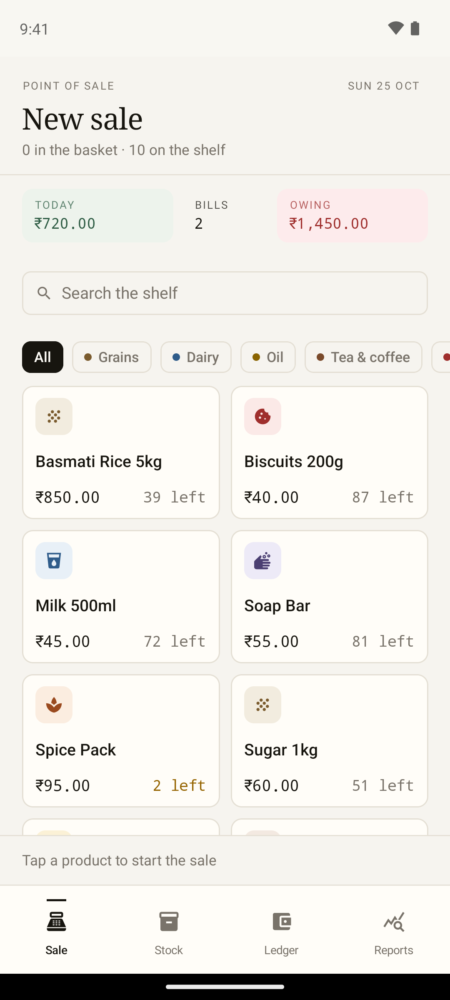
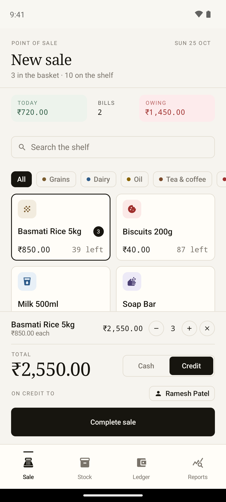
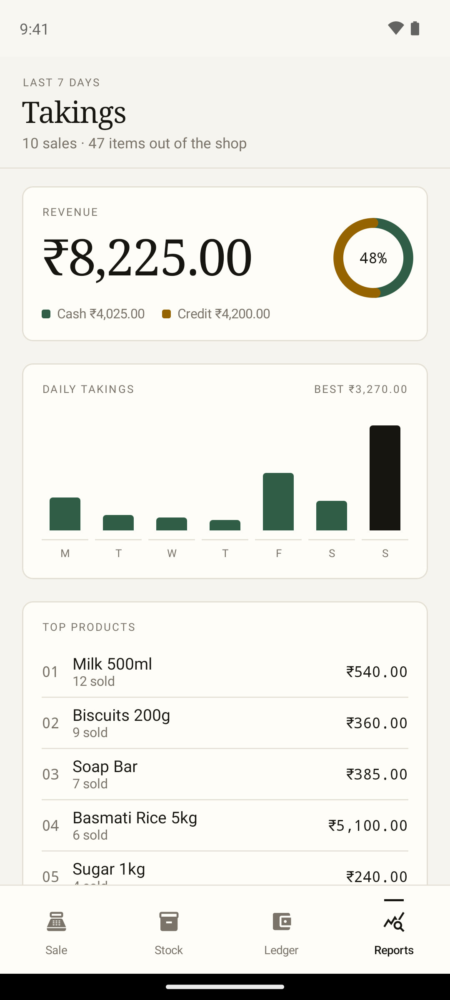
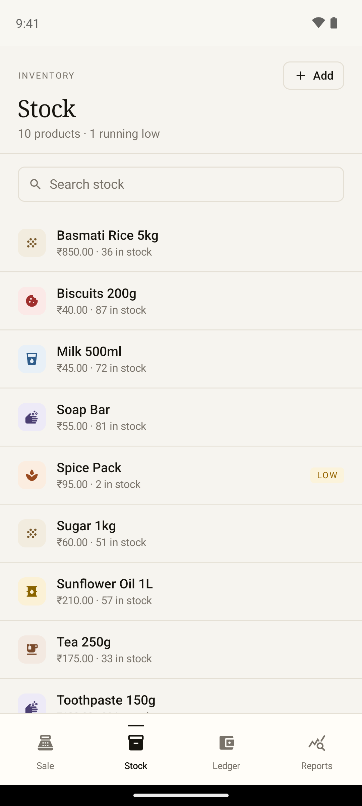
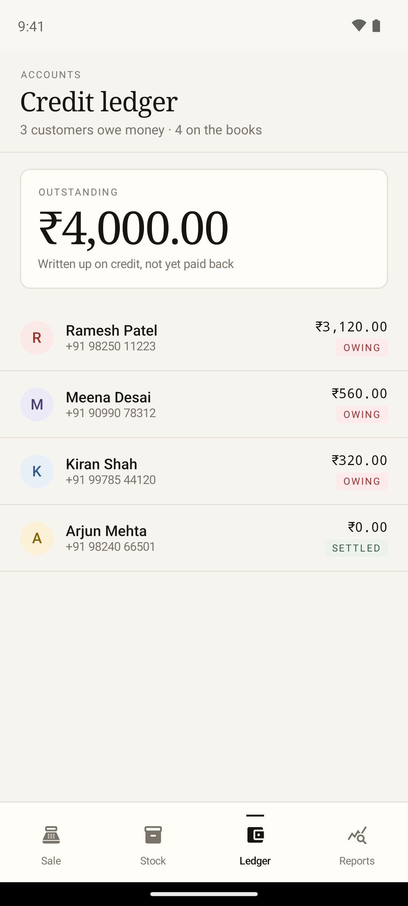
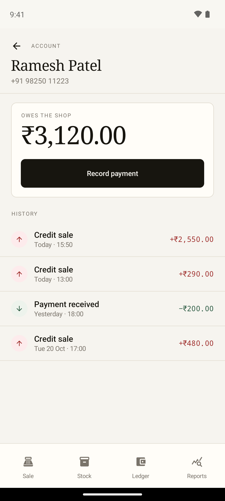

# Slate

A shop ledger for a small store, written in Kotlin and Jetpack Compose.
Ring up a sale, keep the shelf honest, and know who still owes money.

<p>



</p>

## Why it exists

I have shipped this same shop as a Flutter app. This is it rebuilt native for Android, as a way
of working in Kotlin, Compose and Room rather than reading about them.

## What it does

- **Sale** — tap products into a basket, cash or credit, live totals. A credit sale needs a customer.
- **Stock** — add and edit products, set a low-stock line, see what is running out.
- **Ledger** — who owes what, with every credit sale and payment on one history.
- **Takings** — the last seven days: revenue, cash against credit, daily bars, top products.

<p>


<br />
<em>Stock flags only the exceptions. Editing a product includes its shelf, which picks the colour and icon.</em>
</p>

<p>


<br />
<em>Outstanding money across all accounts, then one account with its full history.</em>
</p>

## How it is built

```
core/   domain models, use cases, Room database, repositories
app/    Compose screens, view models, manual DI, theme
```

- **Money in minor units.** `Money` is a value class over cents, so totals never drift through floating point.
- **One write, one transaction.** A sale, its lines, the stock decrement and the credit charge land together in `RoomSaleRepository`.
- **Pure logic stays testable.** Cart maths and report totals sit outside the view models and outside Android.
- **Offline only.** Room is the source of truth, and the app holds no network permission.
- **Small manual DI.** One `SlateContainer`, no annotation processor.

## Tests

```sh
./gradlew test                       # 17 unit tests: money, cart, sale rules, report totals, a view model
./gradlew connectedDebugAndroidTest  # 4 UI tests that drive the real screens, 2 Room integration tests
```

The UI tests record a cash sale, refuse a credit sale with no customer, add a product from the
stock screen, and open a customer account.

## Run it

```sh
./gradlew :app:installDebug
adb shell am start -n com.maazsurti.slate/.MainActivity
```

First launch seeds a week of shop activity, so no screen starts empty.

## Design

Warm paper, hairline rules, serif headings, monospaced figures. Colour is kept for meaning:
each shelf has its own wash and mark, green for cash and settled, clay for low stock and credit,
rust for money owed.

## Licence

MIT. See [LICENCE](LICENCE).
